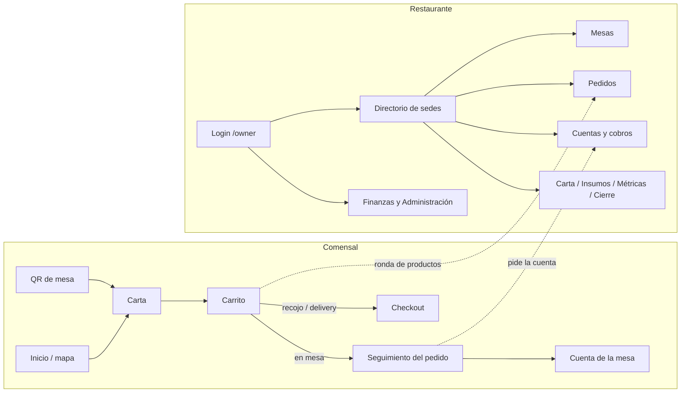
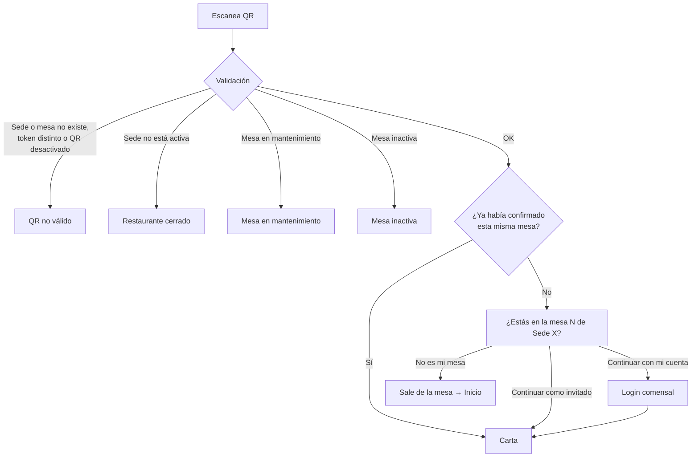
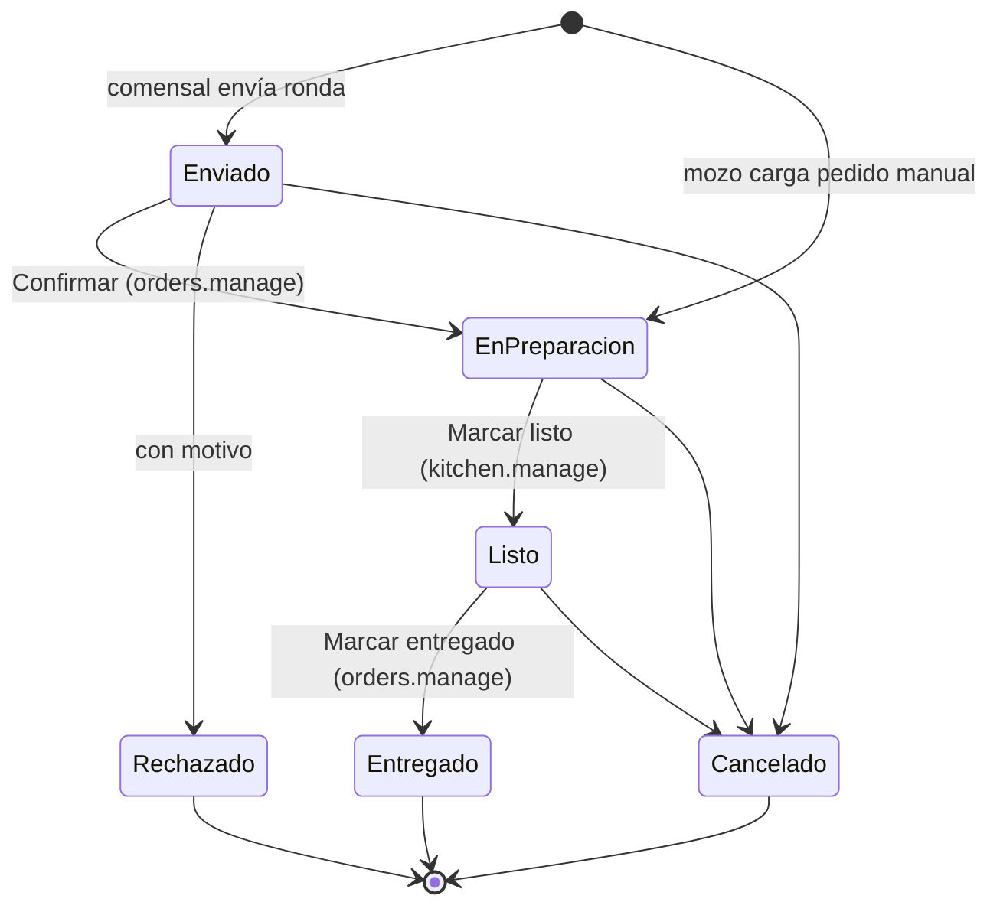
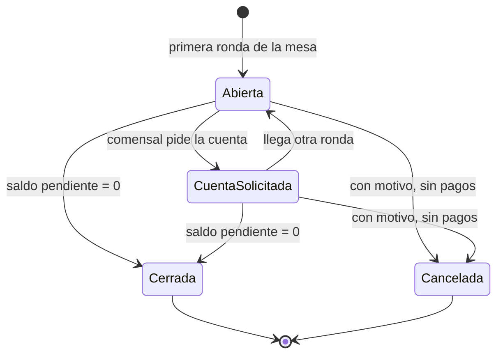
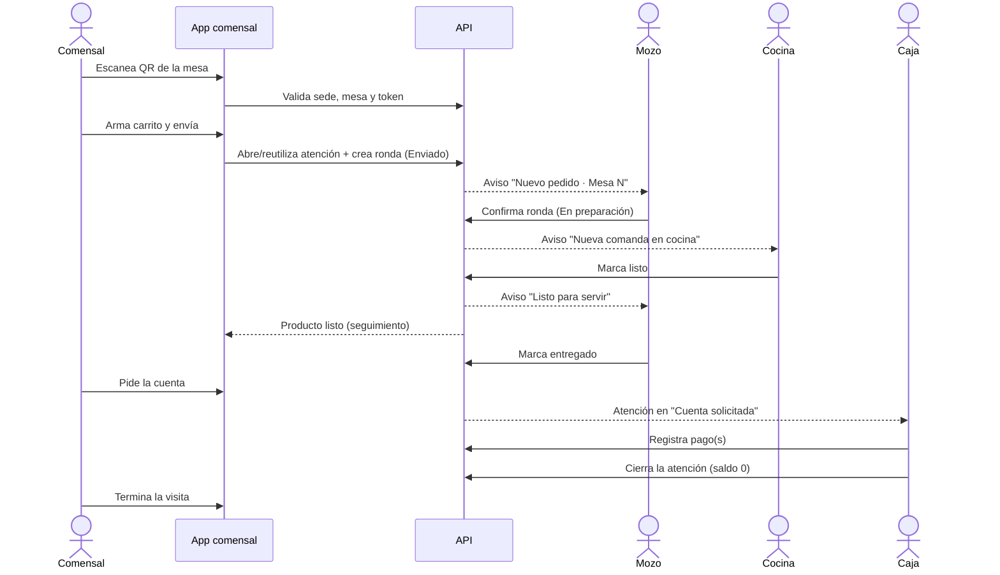
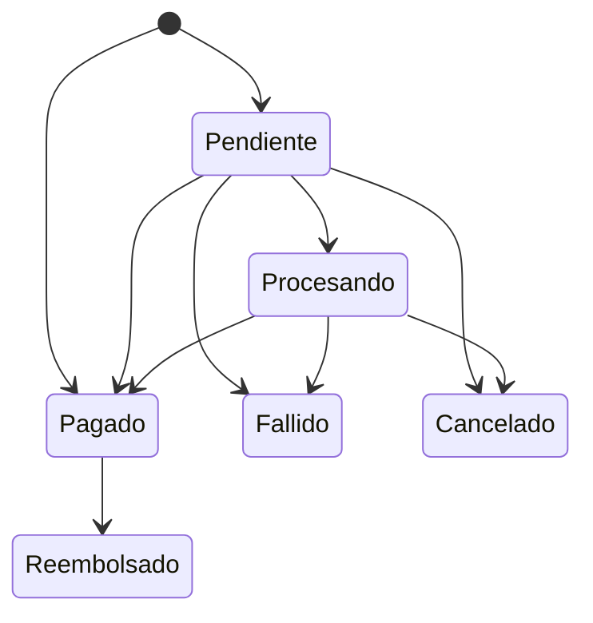

# Flujo completo de la web

Recorrido de punta a punta por la plataforma: qué hace cada tipo de usuario, por qué pantallas pasa y qué reglas se aplican en cada paso.

Documentos relacionados:

- Rutas: [RUTAS.md](../RUTAS.md)
- Pendientes: [PENDIENTES.md](../PENDIENTES.md)
- Tablas: [diseno-tablas.md](diseno-tablas.md) · [modelo-tablas.md](modelo-tablas.md)
- Endpoints: [endpoints-comensal.md](endpoints-comensal.md) · [endpoints-restaurante.md](endpoints-restaurante.md)

---

## Índice

1. [Visión general](#1-visión-general)
2. [Conceptos clave](#2-conceptos-clave)
3. [Acceso y cuentas](#3-acceso-y-cuentas)
4. [Flujo del comensal](#4-flujo-del-comensal)
5. [Flujo del personal en sede](#5-flujo-del-personal-en-sede)
6. [Vida de un pedido de punta a punta](#6-vida-de-un-pedido-de-punta-a-punta)
7. [Cobro y cierre de la cuenta](#7-cobro-y-cierre-de-la-cuenta)
8. [Gestión del local](#8-gestión-del-local)
9. [Dueño: finanzas y administración](#9-dueño-finanzas-y-administración)
10. [Roles y permisos](#10-roles-y-permisos)
11. [Tiempo real, avisos y datos guardados](#11-tiempo-real-avisos-y-datos-guardados)
12. [Estado actual y pendientes](#12-estado-actual-y-pendientes)

---

## 1. Visión general

La web tiene tres públicos, cada uno con su zona:

| Público | Zona | Login | Qué hace |
|---|---|---|---|
| **Comensal** | `/` (raíz) | Opcional | Busca restaurantes, ve la carta, pide en mesa por QR, sigue su pedido, pide la cuenta. También puede pedir para recoger o delivery. |
| **Personal y dueño** | `/owner/*` | Obligatorio | Gestiona mesas, pedidos, cocina, carta, cobros, insumos, métricas y cierre del día. El rol decide qué ve. |
| **Visitante comercial** | `/para-restaurantes` | No | Landing para captar dueños de restaurante. |



Hoy el backend es **json-server** sobre `db.json`. Las reglas de negocio (validaciones, transiciones de estado, idempotencia) viven en el front, en los `api.ts` de cada módulo, y están escritas pensando en el contrato del futuro backend.

---

## 2. Conceptos clave

| Concepto | Qué es |
|---|---|
| **Organización** | La empresa del dueño. Agrupa sus sedes, empleados, roles y categorías de gastos. |
| **Sede (restaurante)** | Un local. Tiene `slug` (se usa en las URLs, ej. `bodega-san-telmo-grand-cru`), moneda, zona horaria, ubicación y modalidades de pedido (en mesa, recojo, delivery). |
| **Piso y mesa** | Cada sede tiene uno o más pisos con mesas. Cada mesa tiene un QR con token propio y un estado operativo: `active`, `inactive` o `maintenance`. |
| **Atención** | La "cuenta" de una mesa desde que se sientan hasta que pagan. Una mesa solo puede tener **una atención activa** a la vez. |
| **Ronda** | Cada envío del carrito (o pedido manual del mozo). Todos sus productos comparten un `batchId`. |
| **Producto solicitado** | Cada línea pedida. Avanza por estados de forma independiente: enviado → en preparación → listo → entregado. |
| **Pago** | Registro de cobro sobre una atención. Puede cubrir todo, un monto o productos concretos (división de cuenta). |

---

## 3. Acceso y cuentas

### 3.1 Punto de entrada único

`/acceso` pregunta **qué tipo de cuenta** tiene el usuario y lo manda al formulario que corresponde. Con `?modo=registro` abre directamente el registro.

```mermaid
flowchart TD
    A[/acceso] --> B{¿Tipo de cuenta?}
    B -->|Cliente| C[/customer/auth/login o /register]
    B -->|Dueño de restaurante| D[/owner/auth/login o /register]
    C --> E[Vuelve a la carta si tenía mesa<br/>o va a /perfil]
    D --> F[Pantalla inicial según rol y sedes]
```

### 3.2 Cuenta del comensal (opcional)

- Se puede usar toda la app como **invitado**. La cuenta sirve para asociar los pedidos al comensal y ver su historial.
- Login / registro en `/customer/auth/login` y `/customer/auth/register`.
- Al terminar vuelve a donde estaba (`?redirect=`); si tenía mesa confirmada, a la carta; si no, a `/perfil`.
- `/perfil`: datos personales, preferencias alimentarias, alérgenos, cambio de contraseña.
- `/mis-visitas`: historial de atenciones del comensal.
- Es una cuenta **independiente** de las del personal: no da acceso a `/owner`.

### 3.3 Cuenta del personal y del dueño

- Login en `/owner/auth/login`. Si ya hay sesión, esas rutas redirigen a la pantalla inicial.
- Registro en `/owner/auth/register`: hoy crea un usuario sin rol ni sedes (ver [pendientes](#12-estado-actual-y-pendientes)).
- Los empleados **no se registran solos**: el dueño les crea el acceso desde Administración → Usuarios.
- Al entrar, cada usuario cae en una pantalla distinta según su rol:

```mermaid
flowchart TD
    A[Login correcto] --> B{¿Tiene permisos?}
    B -->|No| X[/owner/sin-acceso]
    B -->|Sí| C{¿Tiene una sola sede?}
    C -->|Sí| D[Primera vista de sede que su rol permite]
    C -->|No| E{¿Tiene algún permiso de sede?}
    E -->|Sí| F[/owner/dashboard<br/>directorio de sedes]
    E -->|No| G[/owner/admin]
```

Prioridad de la "primera vista de sede": Mesas → Pedidos → Cuentas → Carta → Métricas. Ejemplos: un **camarero** de una sede entra a Pedidos; un **cajero** entra a Cuentas.

### 3.4 Guardas de navegación

Cada vez que se entra a una ruta de `/owner`:

1. Sin sesión → login, guardando `?redirect` para volver.
2. Si la ruta es de sede (`/owner/sede/:slug`), se traduce el slug al id de la sede. Si el slug no existe → 404. Si se llegó con un id o un slug viejo, se corrige la URL.
3. Si el usuario no tiene acceso a esa sede → `/owner/sin-acceso?motivo=sede`.
4. Si no tiene el permiso de la ruta → `/owner/sin-acceso?motivo=permiso`.

Al abrir el portal, el rol y los permisos se vuelven a leer del servidor: un cambio de rol se aplica sin volver a iniciar sesión, y si la cuenta fue bloqueada o desactivada, se cierra la sesión.

---

## 4. Flujo del comensal

### 4.1 Encontrar un restaurante

`/` muestra un **mapa** con las sedes, un buscador (por texto y tipo) y los **restaurantes recientes** del comensal.

- Solo aparecen las sedes **activas** y con coordenadas.
- Con "Cerca de mí" (geolocalización) ordena por distancia.
- Si el comensal tiene un pedido en curso, se le muestra un acceso directo a su seguimiento.
- Al elegir una sede va a su carta: `/:restaurantSlug/menu`.

### 4.2 Entrar por el QR de la mesa

El QR impreso de cada mesa lleva a `/table/:tableId?restaurantId=…&token=…`.



Al validar, la app guarda la sede, la mesa y, si la mesa ya tiene una atención abierta (otra persona del grupo ya pidió), se une a ella.

### 4.3 La carta

`/:restaurantSlug/menu`:

- Categorías con pestañas que siguen el scroll, buscador y detalle de cada plato (descripción, ingredientes, alérgenos, tiempo de preparación).
- Se agregan productos al carrito con cantidad y notas.
- **Sin mesa**: abrir una carta la convierte en la sede actual en modo consulta; igual se puede armar la orden para recojo o delivery.
- **Con mesa en otra sede**: la carta es solo de consulta, para no mezclar carritos.
- El carrito es de **una sola sede**: si cambia de sede, se vacía.

### 4.4 Carrito (`/cart`)

Antes de cualquier envío, la orden se revisa contra la carta vigente: productos eliminados, desactivados, agotados o con precio distinto se señalan para que el comensal los corrija.

Desde aquí el flujo se divide:

```mermaid
flowchart TD
    A[Carrito] --> B{¿Tiene mesa confirmada?}
    B -->|Sí| C[Enviar pedido a la mesa]
    C --> D[Se abre o reutiliza la atención de la mesa]
    D --> E[Se crea la ronda: productos en estado Enviado]
    E --> F[/orders/:attentionId<br/>seguimiento]
    B -->|No| G[Continuar al pago]
    G --> H[/pedido/entrega]
    H --> I[/pago]
    I --> J[/pago/:method]
    J --> K[/pago/listo]
```

### 4.5 Pedido en mesa: enviar ronda

Al pulsar **Enviar**:

1. Se valida la orden contra la carta.
2. Se busca la atención activa de la mesa; si no hay, se abre una (antes se verifica que la sede esté activa y la mesa exista y esté habilitada).
3. Se crean los productos con el **precio y nombre de la carta**, no los del navegador, en estado **Enviado**.
4. Se vacía el carrito y se muestra el acceso al seguimiento.

Protecciones:

- **Idempotencia**: el carrito guarda un `batchId`. Si el envío falla por red y se reintenta, no se duplican productos.
- **Una atención por mesa**: si dos teléfonos abren atención a la vez, se queda la más antigua y la duplicada se cancela.
- Si la mesa ya había **pedido la cuenta** y se manda otra ronda, la atención vuelve a **Abierta**.

El comensal puede pedir **varias rondas** durante la visita; todas suman a la misma atención.

### 4.6 Seguimiento del pedido (`/orders/:attentionId`)

- Se actualiza solo cada ~6 s.
- Muestra cada ronda y el estado de cada producto con su progreso: Enviado → En preparación → Listo → Entregado.
- Avisa cuando un producto pasa a **Listo** o es **Rechazado** (con el motivo).
- Acciones:
  - **Pedir más**: vuelve a la carta.
  - **Pedir la cuenta**: confirma y avisa al personal. Pedirla dos veces no hace nada; después aún se puede pedir algo más.
  - **Ver la cuenta**: va a `/orders/:attentionId/cuenta`.
  - **Terminar la visita**: olvida la mesa en el dispositivo y vuelve al inicio.

### 4.7 Cuenta de la mesa (`/orders/:attentionId/cuenta`)

Vista de solo lectura para el comensal (se actualiza cada ~8 s):

- Total cobrable (no cuenta productos rechazados ni cancelados), pagado y saldo pendiente.
- Pagos registrados por el personal: hora, método, quién pagó y estado.
- Botón **Solicitar la cuenta** si aún no la pidió.

El cobro de la mesa lo registra el personal (ver [sección 7](#7-cobro-y-cierre-de-la-cuenta)).

### 4.8 Recojo y delivery (checkout)

Para quien pide **sin estar sentado en una mesa**.

**Paso 1 · Entrega (`/pedido/entrega`)** — elige modalidad entre las que ofrece la sede:

| Modalidad | Qué pide | Validaciones |
|---|---|---|
| **En mesa** | Código de la mesa | Obligatorio. Se precarga si llegó por QR. |
| **Llego al local** (recojo) | Nombre, teléfono, hora de llegada, comer allí o para llevar | Horarios cada 15 min desde que el pedido puede estar listo y durante 3 h. |
| **Delivery** | Nombre, teléfono, dirección, referencia, ubicación opcional | Pedido mínimo de la sede; si comparte ubicación, debe estar dentro del radio de entrega. Suma el costo de envío. |

La hora estimada se calcula con el plato más lento del carrito más un margen.

**Paso 2 · Método de pago (`/pago`)** — tarjeta, Yape, Plin o transferencia. (Efectivo tiene vista pero está oculto.)

**Paso 3 · Pago (`/pago/:method`)** — formulario del método elegido.

**Paso 4 · Resultado (`/pago/listo`)** — comprobante con código (`M-`, `R-` o `D-` + número), detalle, total y hora estimada.

> ⚠️ Hoy este flujo es **solo visual**: no hay pasarela de pago y el pedido no se registra en la base, así que el personal no lo ve. Si se llega a un paso sin completar el anterior, la app redirige al paso que falta.

---

## 5. Flujo del personal en sede

### 5.1 Directorio de sedes (`/owner/dashboard`)

Lista de las sedes a las que el usuario tiene acceso, con sus KPIs. Desde aquí se entra a cada sede. El menú lateral de la sede muestra solo las secciones que el rol permite.

### 5.2 Mesas (`/owner/sede/:local`) · `sites.manage`

- Plano de sala por pisos (o "Todos" agrupado por piso).
- El estado de cada mesa se calcula con las atenciones reales: **ocupada** si tiene una atención activa; si no, respeta reservada / limpieza / disponible.
- Crear, editar y mover mesas entre pisos (también arrastrando). Gestionar pisos.
- Cambiar el estado operativo de la mesa (activa, inactiva, mantenimiento) y activar o desactivar su QR.
- **Imprimir QRs**: hoja con el QR de cada mesa activa.
- Ver el detalle de la mesa y su atención en curso.

### 5.3 Pedidos (`/owner/sede/:local/pedidos`) · `orders.manage`

Dos vistas (queda en la URL):

- **Tablero** (por defecto): columnas por estado, estilo Jira. Cada tarjeta es una **comanda** = productos de una misma ronda de una mesa en ese estado. Se avanza arrastrando a la columna siguiente o con su botón. Las comandas se marcan como demoradas según el tiempo.
- **Lista**: rondas pendientes de confirmar + atenciones en curso.

Acciones:

- **Confirmar** una ronda (pasa directo a cocina), **rechazar** productos con motivo, **cancelar** productos.
- **Pedido manual** del mozo: entra directo **En preparación** (no necesita confirmación).
- Detalle del pedido (`/pedidos/:attentionId`) con el historial de cambios de estado: quién, cuándo y por qué.
- **Cancelar la atención** completa con motivo (solo si no tiene pagos).

Cuando una atención se cierra, sus comandas salen del tablero.

### 5.4 Cocina (`/owner/sede/:local/cocina`) · `kitchen.manage`

> Deshabilitada por ahora (`FEATURES.kitchenQueue = false`): redirige a Pedidos. El código se conserva para reactivarla.

### 5.5 Cuentas y cobros (`/owner/sede/:local/cuentas`) · `payments.manage`

- Lista de atenciones: primero las que **pidieron la cuenta** (la más antigua arriba), luego las abiertas y al final las cerradas recientes.
- Detalle de cuenta (`/cuentas/:attentionId`) para registrar pagos y cerrar.
- Pestaña **Gastos** (`?vista=gastos`): ver [sección 8](#8-gestión-del-local).

---

## 6. Vida de un pedido de punta a punta

### 6.1 Estados del producto solicitado



| Estado | Significado | Quién lo avanza |
|---|---|---|
| Enviado | El restaurante aún no lo confirmó | Mozo / jefe de sala (`orders.manage`) |
| En preparación | En cocina | Cocina (`kitchen.manage`) |
| Listo | En el pase, para llevar a la mesa | Mozo (`orders.manage`) |
| Entregado | Ya está en la mesa | — |
| Rechazado | La sede no lo puede servir (requiere motivo) | — |
| Cancelado | Anulado | — |

Reglas:

- **Control de concurrencia**: al cambiar un estado se compara con el que vio el usuario. Si otro empleado ya lo cambió, se informa el conflicto y no se pisa.
- Los cambios en lote informan los que fallaron sin cortar el resto.
- Todo cambio queda en el **historial de estados**.

Umbrales de demora: sin confirmar > 5 min, en cocina > 15 min, esperando en el pase > 5 min. Al doble del umbral se marca como **muy demorado**.

### 6.2 Estados de la atención



### 6.3 Secuencia completa de una mesa



---

## 7. Cobro y cierre de la cuenta

Desde el detalle de la cuenta, el personal con `payments.manage` registra los pagos.

### 7.1 Modos de cobro

| Modo | Uso |
|---|---|
| **Todo** | Cobra el saldo pendiente completo. |
| **Un monto** | Cobra una cantidad libre (ej. dividir en partes iguales entre N personas). |
| **Por productos** | Asigna el pago a productos concretos; permite pagar una fracción de un plato compartido. |

Datos del pago: método (efectivo, tarjeta, transferencia, Yape, Plin, otro), referencia externa, nombre de quien paga y opción de dejarlo **pendiente de confirmación**.

### 7.2 Reglas del cobro

- El monto debe ser mayor que cero y **no superar el saldo pendiente**.
- No se puede asignar a un producto más de lo que tiene pendiente, ni a productos rechazados o cancelados.
- La suma asignada a productos debe coincidir con el monto.
- No se puede cobrar una atención cerrada o cancelada.
- Un reintento con el mismo `requestId` no duplica el pago.

### 7.3 Estados del pago



Solo los pagos **Pagado** cuentan para el saldo. Confirmar un pago pendiente se rechaza si superaría el saldo.

### 7.4 Cierre

- La atención solo se **cierra** cuando el saldo pendiente es **cero**.
- Una atención sin nada que cobrar (todo rechazado o sin pedidos) se cierra sin pagos.
- Una atención con pagos **no se puede cancelar**: primero hay que reembolsar.
- Al cerrarse, la mesa queda libre en el plano y sus comandas salen del tablero.

---

## 8. Gestión del local

### 8.1 Carta (`/owner/sede/:local/menu`) · `menu.manage`

- Categorías y productos: crear, editar, ordenar, activar / desactivar.
- Cambio rápido de **disponibilidad** desde la tarjeta (agotado).
- Vista previa de cómo lo ve el comensal.
- Lo que se desactiva o agota aquí se detecta al validar el carrito del comensal.

### 8.2 Insumos (`/owner/sede/:local/insumos`) · `inventory.manage`

- **Stock**: lista de insumos por categoría con nivel respecto al mínimo; primero lo que hay que reponer.
- **Movimientos** (`?vista=movimientos`, `&insumo=id` para uno): el stock **solo cambia con movimientos**.

| Movimiento | Efecto |
|---|---|
| Entrada (compra) | Suma stock. Si se marca como gasto, crea el gasto en Cuentas → Gastos. |
| Salida (uso) | Resta stock. |
| Merma | Resta stock (pérdida). |
| Conteo | Ajusta el stock al valor contado. |

- Resumen del mes: compras y mermas valorizadas.

### 8.3 Gastos (`/owner/sede/:local/cuentas?vista=gastos`)

Gastos de la sede por categoría (insumos, sueldos, alquiler, servicios…). Las categorías son de la organización y se comparten entre sedes. Al borrar una categoría, sus gastos se mueven a otra.

### 8.4 Métricas (`/owner/sede/:local/metricas`) · `reports.view`

Indicadores de la sede por período, calculados con atenciones, productos y pagos reales.

### 8.5 Cierre del día (`/owner/sede/:local/cierre`) · `reports.view`

- Resumen de la fecha: cobrado, atenciones cerradas, abiertas y canceladas.
- Desglose **por método de pago** y **por empleado que cobró**.
- **Registrar cierre** (o actualizarlo si ya existía para esa fecha). Si quedan atenciones abiertas, avisa antes de registrar.
- Historial de cierres registrados.

---

## 9. Dueño: finanzas y administración

### 9.1 Finanzas (`/owner/finanzas`) · `reports.view`

- Ganancias de la cadena por local, con filtros día / mes / año.
- Compara con el período anterior. Si el período está en curso, compara el mismo número de días (1–11 oct vs. 1–11 sep).
- Cada sede mantiene su color aunque se filtre.
- `/owner/finanzas/:restaurantId`: detalle de ingresos y gastos de un local.

> Hoy usa datos de demostración (`dailyFinancials`), no las ventas y gastos reales.

### 9.2 Administración (`/owner/admin`)

| Sección | Permiso | Qué hace |
|---|---|---|
| Empleados | `staff.manage` | Alta y edición de empleados: sede, área (cocina, sala, apoyo), estado. |
| Usuarios | `users.manage` | Accesos al portal: rol, sedes, activar, bloquear. |
| Roles | `users.manage` | Crear roles y elegir sus permisos. |
| Inventario | `inventory.manage` | Vista de inventario de todas las sedes. |
| Restaurantes | `org.manage` | Alta y edición de sedes (el código no se edita luego). Una sede nueva se crea con su plano vacío. |
| Configuración | `org.manage` | Datos de la organización. |

### 9.3 Perfil (`/owner/cuenta`)

Datos personales del usuario, su ficha de empleado y cambio de contraseña.

---

## 10. Roles y permisos

### 10.1 Permisos

| Permiso | Habilita |
|---|---|
| `org.manage` | Organización y sedes |
| `users.manage` | Usuarios y roles |
| `staff.manage` | Empleados |
| `sites.manage` | Sala, mesas y QR |
| `orders.manage` | Gestión de pedidos y pedido manual |
| `kitchen.manage` | Cola de cocina / marcar listo |
| `menu.manage` | Menú y productos |
| `payments.manage` | Cuentas y cobros (y hoy también Gastos) |
| `inventory.manage` | Inventario e insumos |
| `reports.view` | Métricas, cierre del día y finanzas |

### 10.2 Roles de ejemplo (`db.json`)

| Rol | Permisos | Pantalla inicial (una sede) |
|---|---|---|
| Propietario | Todos | Mesas |
| Gerente de sede | Todos menos `org.manage` y `users.manage` | Mesas |
| Jefe de cocina | Pedidos, cocina, carta, inventario | Pedidos |
| Jefe de sala | Mesas, pedidos, cobros | Mesas |
| Camarero | Pedidos | Pedidos |
| Sumiller | Carta, inventario | Carta |
| Cajero | Cobros, reportes | Cuentas |

Además del permiso, cada usuario tiene una lista de **sedes**: solo puede entrar a esas. Lista vacía = todas.

---

## 11. Tiempo real, avisos y datos guardados

### 11.1 Actualización automática

Mientras no haya backend con sockets, todo se actualiza por **polling** (se pausa si la pestaña no está visible):

| Pantalla | Cada |
|---|---|
| Actividad de la sede en el portal | 8 s |
| Seguimiento del pedido (comensal) | 6 s |
| Cuenta de la mesa (comensal) | 8 s |

### 11.2 Avisos al personal

El portal muestra avisos según el rol de quien está conectado:

| Aviso | Lo ve quien tiene |
|---|---|
| Nuevo pedido · Mesa N | `orders.manage` |
| Nueva comanda en cocina · Mesa N | `kitchen.manage` |
| Listo para servir · Mesa N | `orders.manage` |

También hay contadores de: productos por confirmar, en preparación, listos y atenciones con cuenta solicitada.

### 11.3 Qué se guarda en el navegador del comensal

| Dato | Para qué |
|---|---|
| Sede, mesa, confirmación, atención en curso, cuenta | Sobrevivir a un refresh o cerrar la pestaña |
| Carrito y su `batchId` | No perder la orden ni duplicar envíos |
| Restaurantes recientes (máx. 6) | Mostrarlos en el inicio |
| Código de mesa | Precargar "En mesa" en el checkout |
| Borrador del checkout | No perder datos de entrega al volver atrás |

Si cambia de mesa o de sede, se olvida la atención anterior.

---

## 12. Estado actual y pendientes

Detalle completo en [PENDIENTES.md](../PENDIENTES.md). Lo más relevante para el flujo:

**Funciona de punta a punta**

- QR de mesa → carta → rondas → tablero de pedidos → cocina → entrega.
- Pedir la cuenta → cobro (total, monto, por productos) → cierre de la atención.
- Mesas, carta, insumos, gastos, métricas y cierre del día.
- Login del personal con permisos por rol y por sede.

**Solo visual o incompleto**

- Checkout de **recojo y delivery**: no cobra ni registra el pedido; el personal no lo ve.
- **Métodos de pago** sin integración con pasarela.
- **Registro de dueño**: no crea la organización ni la primera sede, y el usuario queda sin rol.
- **Cuentas de empleados**: falta contraseña temporal y cambio obligatorio en el primer ingreso; las contraseñas están en texto plano en `db.json`.
- **Finanzas**: datos de demostración, sin usar las ventas ni los gastos reales.
- **Cola de cocina**: desactivada por feature flag.
- **Recetas**: los platos no descuentan insumos al venderse.
- Configurar desde administración las modalidades de cada sede y marcar platos que no van para llevar.

**Cuando llegue el backend (NestJS)**

- Mover las validaciones y transiciones de estado al servidor (hoy en los `api.ts`).
- Reemplazar el polling por sockets.
- Validar permisos y sedes en el servidor, no solo en el navegador.
